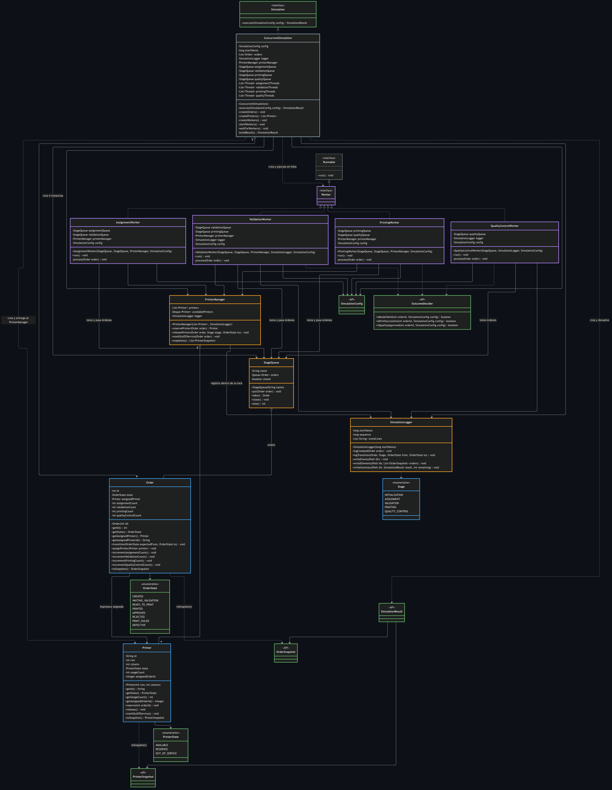
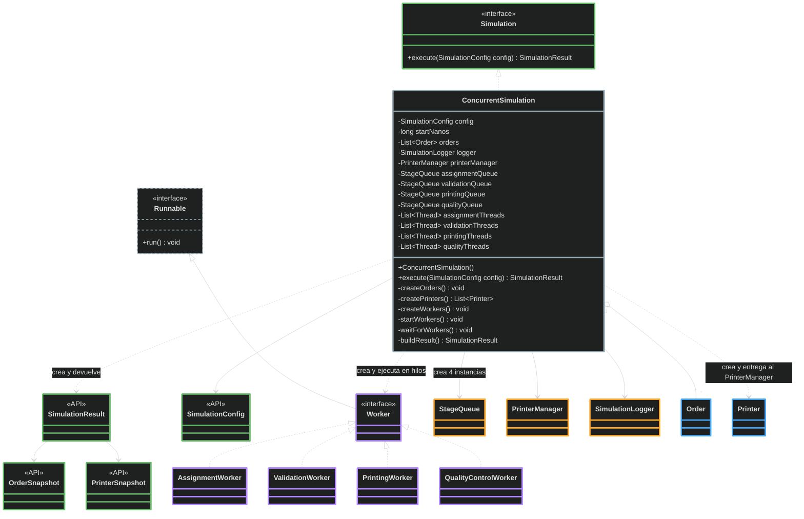
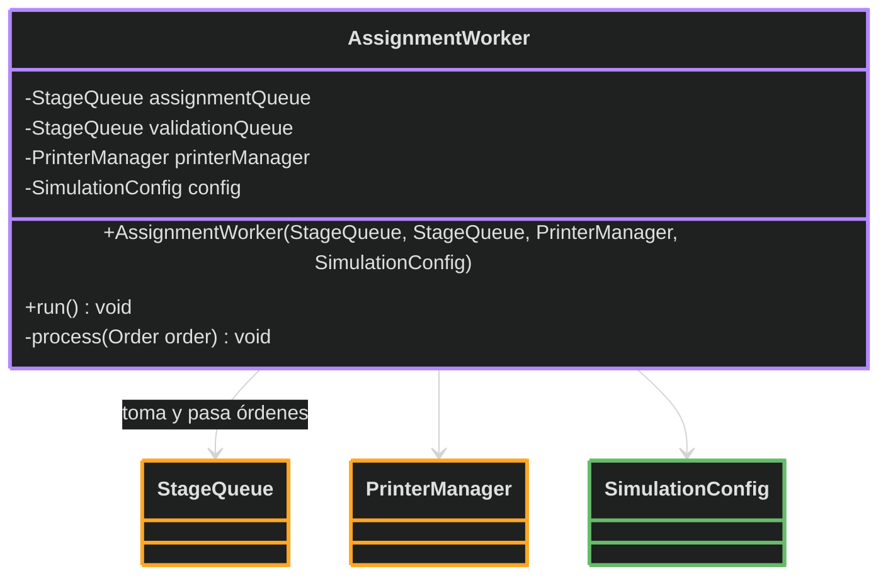
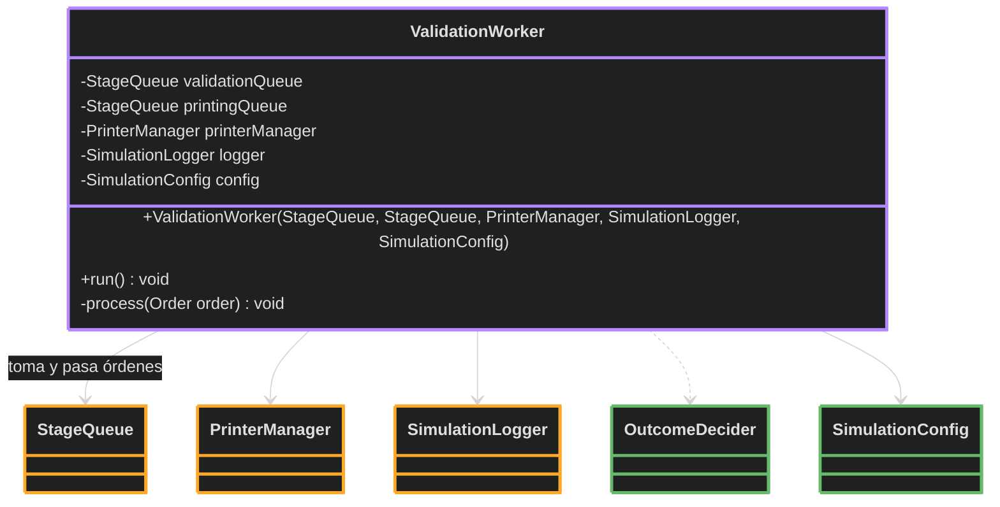
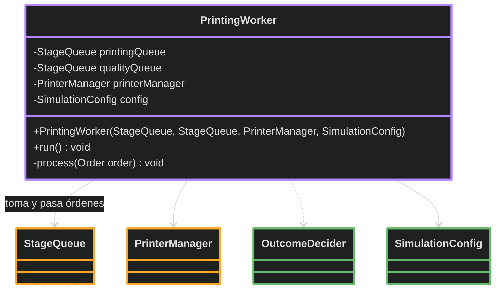
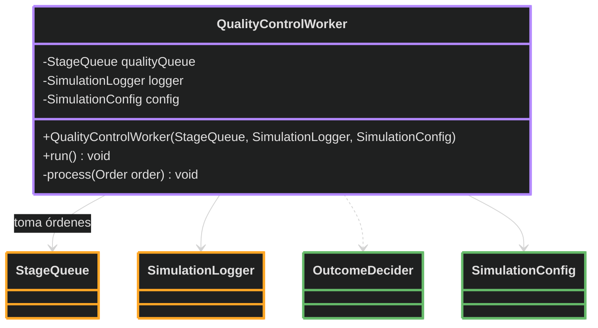
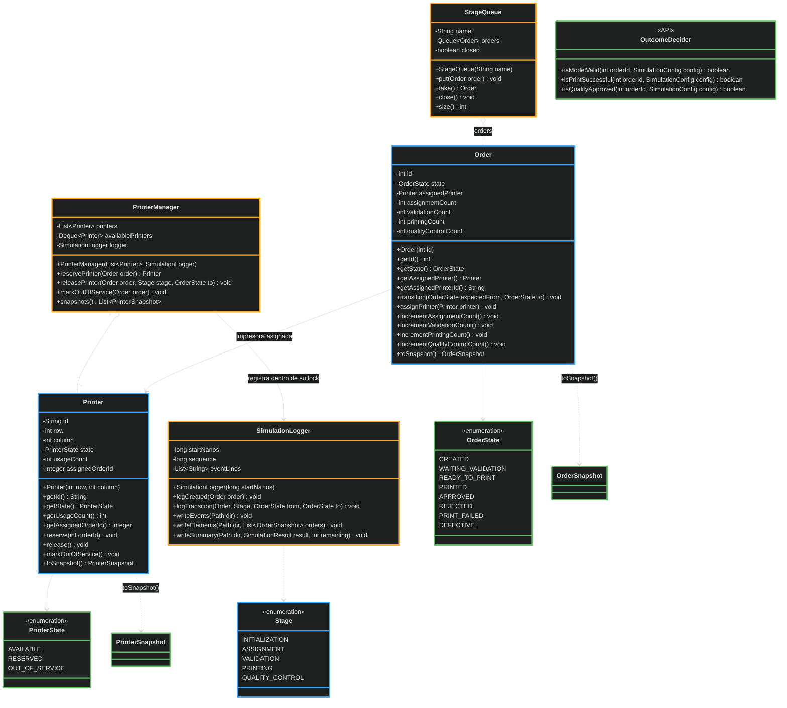

# Diagrama de clases

Modelo acordado por el equipo: una línea de producción concurrente con 4 etapas (asignación,
validación, impresión y control de calidad), comunicadas por 4 instancias de `StageQueue`. El detalle de
cada clase (qué hace cada método y qué reglas de sincronización respeta) está en
[division-de-trabajo.md](division-de-trabajo.md).

- **Diseño propio** (paquete `ar.edu.unc.fcefyn.pcp.tp1.solution`): `ConcurrentSimulation`, `Order`,
  `Printer`, `Stage`, `Worker`, los 4 workers, `StageQueue`, `PrinterManager` y `SimulationLogger`.
- **Provisto por la cátedra (paquete `api`):** la interfaz `Simulation`, `SimulationConfig`,
  `SimulationResult`, `OrderSnapshot`, `PrinterSnapshot`, `OutcomeDecider` y los estados `OrderState` y
  `PrinterState`.
- **Java estándar:** `Runnable`.

| Color del borde | Grupo | Clases |
|---|---|---|
| Gris | Coordinación | `ConcurrentSimulation` |
| Gris punteado | Java estándar | `Runnable` |
| Violeta | Hilos (workers) | `Worker` y sus 4 implementaciones |
| Naranja | Recursos compartidos (sincronizados) | `StageQueue`, `PrinterManager`, `SimulationLogger` |
| Azul | Dominio propio | `Order`, `Printer`, `Stage` |
| Verde | API de la cátedra | `Simulation`, `SimulationConfig`, `SimulationResult`, snapshots, `OutcomeDecider`, estados |

| Línea | Relación | Significado | Ejemplo |
|---|---|---|---|
| Sólida, con punta de flecha | Asociación | La clase guarda una referencia como atributo | `PrinterManager` → `SimulationLogger` |
| Sólida, con rombo vacío | Agregación | La clase guarda una colección de esos objetos (el rombo va del lado de quien la guarda) | `PrinterManager` → `Printer` |
| Punteada, con punta de flecha | Dependencia | La usa sin guardarla: la crea, la devuelve, la recibe como parámetro o llama a sus métodos estáticos | `ValidationWorker` → `OutcomeDecider` |
| Sólida, con triángulo vacío | Herencia | Una interfaz extiende otra | `Worker` → `Runnable` |
| Punteada, con triángulo vacío | Implementación | La clase implementa la interfaz | `ConcurrentSimulation` → `Simulation` |

## Diagrama completo

Es el entregable `docs/diagrama-clases.png` que pide el enunciado: todas las clases y todas las
relaciones en una sola imagen.

Cómo leerlo:

- Se lee de arriba hacia abajo, por capas:
  1. `Simulation`, la interfaz de la API que exige el enunciado, y `ConcurrentSimulation`, que la
     implementa: crea todo, inicia los hilos y hace `join()`.
  2. `Worker` (que extiende `Runnable`) y los 4 workers, en el orden del pipeline: asignación,
     validación, impresión y control de calidad.
  3. Lo que usan los workers: los recursos compartidos (`PrinterManager`, `StageQueue`,
     `SimulationLogger`) y las clases de la API que consultan (`SimulationConfig`, `OutcomeDecider`).
  4. El dominio (`Order`, `Printer`, `Stage` y los estados).
  5. Lo que devuelve `execute` (`SimulationResult` y los snapshots).
- Cada relación tiene su propia línea y su propia flecha; las líneas solo giran en ángulo recto.
  Donde dos líneas se cruzan, ninguna cambia de dirección en el cruce.
- El color del borde indica el grupo de cada clase y el tipo de línea, la clase de relación (tablas
  de arriba).
- La imagen se genera con el layout ELK de Mermaid. Si un visor no soporta ELK, el código de abajo se
  dibuja con el layout por defecto y queda más desordenado; la referencia es el PNG.

```mermaid
%%{init: {'theme': 'dark', 'layout': 'elk', 'elk': {'considerModelOrder': 'NODES_AND_EDGES', 'nodePlacementStrategy': 'LINEAR_SEGMENTS', 'forceNodeModelOrder': true}, 'themeCSS': '.edgeTerminals { font-size: 20px !important; font-weight: bold; } .edgeTerminals foreignObject { width: 28px !important; height: 30px !important; overflow: visible !important; }'}}%%
classDiagram
direction TB
class Simulation {
    <<interface>>
    +execute(SimulationConfig config) SimulationResult
}
class ConcurrentSimulation {
    -SimulationConfig config
    -long startNanos
    -List~Order~ orders
    -SimulationLogger logger
    -PrinterManager printerManager
    -StageQueue assignmentQueue
    -StageQueue validationQueue
    -StageQueue printingQueue
    -StageQueue qualityQueue
    -List~Thread~ assignmentThreads
    -List~Thread~ validationThreads
    -List~Thread~ printingThreads
    -List~Thread~ qualityThreads
    +ConcurrentSimulation()
    +execute(SimulationConfig config) SimulationResult
    -createOrders() void
    -createPrinters() List~Printer~
    -createWorkers() void
    -startWorkers() void
    -waitForWorkers() void
    -buildResult() SimulationResult
}
class Runnable {
    <<interface>>
    +run() void
}
class Worker {
    <<interface>>
}
class AssignmentWorker {
    -StageQueue assignmentQueue
    -StageQueue validationQueue
    -PrinterManager printerManager
    -SimulationConfig config
    +AssignmentWorker(StageQueue, StageQueue, PrinterManager, SimulationConfig)
    +run() void
    -process(Order order) void
}
class ValidationWorker {
    -StageQueue validationQueue
    -StageQueue printingQueue
    -PrinterManager printerManager
    -SimulationLogger logger
    -SimulationConfig config
    +ValidationWorker(StageQueue, StageQueue, PrinterManager, SimulationLogger, SimulationConfig)
    +run() void
    -process(Order order) void
}
class PrintingWorker {
    -StageQueue printingQueue
    -StageQueue qualityQueue
    -PrinterManager printerManager
    -SimulationConfig config
    +PrintingWorker(StageQueue, StageQueue, PrinterManager, SimulationConfig)
    +run() void
    -process(Order order) void
}
class QualityControlWorker {
    -StageQueue qualityQueue
    -SimulationLogger logger
    -SimulationConfig config
    +QualityControlWorker(StageQueue, SimulationLogger, SimulationConfig)
    +run() void
    -process(Order order) void
}
class PrinterManager {
    -List~Printer~ printers
    -Deque~Printer~ availablePrinters
    -SimulationLogger logger
    +PrinterManager(List~Printer~, SimulationLogger)
    +reservePrinter(Order order) Printer
    +releasePrinter(Order order, Stage stage, OrderState to) void
    +markOutOfService(Order order) void
    +snapshots() List~PrinterSnapshot~
}
class SimulationConfig {
    <<API>>
}
class OutcomeDecider {
    <<API>>
    +isModelValid(int orderId, SimulationConfig config)$ boolean
    +isPrintSuccessful(int orderId, SimulationConfig config)$ boolean
    +isQualityApproved(int orderId, SimulationConfig config)$ boolean
}
class StageQueue {
    -String name
    -Queue~Order~ orders
    -boolean closed
    +StageQueue(String name)
    +put(Order order) void
    +take() Order
    +close() void
    +size() int
}
class SimulationLogger {
    -long startNanos
    -long sequence
    -List~String~ eventLines
    +SimulationLogger(long startNanos)
    +logCreated(Order order) void
    +logTransition(Order, Stage, OrderState from, OrderState to) void
    +writeEvents(Path dir) void
    +writeElements(Path dir, List~OrderSnapshot~ orders) void
    +writeSummary(Path dir, SimulationResult result, int remaining) void
}
class Order {
    -int id
    -OrderState state
    -Printer assignedPrinter
    -int assignmentCount
    -int validationCount
    -int printingCount
    -int qualityControlCount
    +Order(int id)
    +getId() int
    +getState() OrderState
    +getAssignedPrinter() Printer
    +getAssignedPrinterId() String
    +transition(OrderState expectedFrom, OrderState to) void
    +assignPrinter(Printer printer) void
    +incrementAssignmentCount() void
    +incrementValidationCount() void
    +incrementPrintingCount() void
    +incrementQualityControlCount() void
    +toSnapshot() OrderSnapshot
}
class Stage {
    <<enumeration>>
    INITIALIZATION
    ASSIGNMENT
    VALIDATION
    PRINTING
    QUALITY_CONTROL
}
class OrderState {
    <<enumeration>>
    CREATED
    WAITING_VALIDATION
    READY_TO_PRINT
    PRINTED
    APPROVED
    REJECTED
    PRINT_FAILED
    DEFECTIVE
}
class SimulationResult {
    <<API>>
}
class Printer {
    -String id
    -int row
    -int column
    -PrinterState state
    -int usageCount
    -Integer assignedOrderId
    +Printer(int row, int column)
    +getId() String
    +getState() PrinterState
    +getUsageCount() int
    +getAssignedOrderId() Integer
    +reserve(int orderId) void
    +release() void
    +markOutOfService() void
    +toSnapshot() PrinterSnapshot
}
class OrderSnapshot {
    <<API>>
}
class PrinterState {
    <<enumeration>>
    AVAILABLE
    RESERVED
    OUT_OF_SERVICE
}
class PrinterSnapshot {
    <<API>>
}
Simulation <|.. ConcurrentSimulation
ConcurrentSimulation --> SimulationConfig
ConcurrentSimulation ..> SimulationResult : crea y devuelve
ConcurrentSimulation ..> Worker : crea y ejecuta en hilos
ConcurrentSimulation --> StageQueue : crea 4 instancias
ConcurrentSimulation --> PrinterManager
ConcurrentSimulation --> SimulationLogger
ConcurrentSimulation "1" o-- "*" Order
ConcurrentSimulation ..> Printer : crea y entrega al PrinterManager
SimulationResult --> OrderSnapshot
SimulationResult --> PrinterSnapshot
Runnable <|-- Worker
Worker <|.. AssignmentWorker
Worker <|.. ValidationWorker
Worker <|.. PrintingWorker
Worker <|.. QualityControlWorker
AssignmentWorker --> StageQueue : toma y pasa órdenes
AssignmentWorker --> PrinterManager
AssignmentWorker --> SimulationConfig
ValidationWorker --> StageQueue : toma y pasa órdenes
ValidationWorker --> PrinterManager
ValidationWorker --> SimulationLogger
ValidationWorker ..> OutcomeDecider
ValidationWorker --> SimulationConfig
PrintingWorker --> StageQueue : toma y pasa órdenes
PrintingWorker --> PrinterManager
PrintingWorker ..> OutcomeDecider
PrintingWorker --> SimulationConfig
QualityControlWorker --> StageQueue : toma órdenes
QualityControlWorker --> SimulationLogger
QualityControlWorker ..> OutcomeDecider
QualityControlWorker --> SimulationConfig
PrinterManager "1" o-- "*" Printer
PrinterManager --> SimulationLogger : registra dentro de su lock
SimulationLogger ..> Stage
Order --> Printer : impresora asignada
Order --> OrderState
Printer --> PrinterState
Order ..> OrderSnapshot : toSnapshot()
Printer ..> PrinterSnapshot : toSnapshot()
StageQueue o-- Order : orders
style Simulation stroke:#66BB6A,stroke-width:3px
style ConcurrentSimulation stroke:#90A4AE,stroke-width:3px
style Runnable stroke:#90A4AE,stroke-width:2px,stroke-dasharray:5 5
style Worker stroke:#B388FF,stroke-width:3px
style AssignmentWorker stroke:#B388FF,stroke-width:3px
style ValidationWorker stroke:#B388FF,stroke-width:3px
style PrintingWorker stroke:#B388FF,stroke-width:3px
style QualityControlWorker stroke:#B388FF,stroke-width:3px
style PrinterManager stroke:#FFA726,stroke-width:3px
style SimulationConfig stroke:#66BB6A,stroke-width:3px
style OutcomeDecider stroke:#66BB6A,stroke-width:3px
style StageQueue stroke:#FFA726,stroke-width:3px
style SimulationLogger stroke:#FFA726,stroke-width:3px
style Order stroke:#42A5F5,stroke-width:3px
style Stage stroke:#42A5F5,stroke-width:3px
style OrderState stroke:#66BB6A,stroke-width:3px
style SimulationResult stroke:#66BB6A,stroke-width:3px
style Printer stroke:#42A5F5,stroke-width:3px
style OrderSnapshot stroke:#66BB6A,stroke-width:3px
style PrinterState stroke:#66BB6A,stroke-width:3px
style PrinterSnapshot stroke:#66BB6A,stroke-width:3px
```

Código Mermaid del diagrama completo

## Vistas parciales

Las mismas clases y relaciones, divididas en tres vistas más chicas para leer cada parte en detalle.
Cada clase aparece con su detalle (atributos y métodos) en una sola vista; en las demás figura solo por
nombre. Entre las tres vistas están todas las clases y todas las relaciones del diagrama completo.

### Vista 1. Estructura: coordinador y workers

`ConcurrentSimulation` implementa `Simulation`, la interfaz de la API que exige el enunciado. Crea todos
los objetos, inicia los hilos y espera su fin con `join()`. Guarda las órdenes (las necesita al final
para armar el resultado), pero no las impresoras: `createPrinters()` las entrega directamente al
`PrinterManager`, que es su único dueño. Tampoco guarda los workers, sino los hilos que los ejecutan
(`List<Thread>`); por eso su relación con `Worker` es una dependencia, igual que con `SimulationResult`,
que crea y devuelve. Los cuatro workers implementan `Worker`, que extiende `Runnable` para poder
ejecutarse con `new Thread(worker, nombre)`.

### Vista 2. Cada worker y sus dependencias

Todos los workers reciben sus dependencias por constructor y siguen el mismo ciclo en `run()`:
`take()` de su cola → demora de la etapa → `process(order)`. Asignación, validación e impresión pasan la
orden a la cola siguiente; control de calidad solo toma, porque sus órdenes terminan ahí.

Asignación e impresión no tienen logger: todas sus transiciones pasan por `PrinterManager`, que las
registra dentro de su lock (regla R3 de [division-de-trabajo.md](division-de-trabajo.md)). El evento
igual sale con el nombre del hilo del worker, porque `PrinterManager` se ejecuta en el hilo que lo
llama. `OutcomeDecider` se usa a través de métodos estáticos, por eso es una dependencia.

| Worker | `StageQueue` | `PrinterManager` | `SimulationLogger` | `OutcomeDecider` | `SimulationConfig` |
|---|:---:|:---:|:---:|:---:|:---:|
| `AssignmentWorker` | toma y pasa | ✓ | | | ✓ |
| `ValidationWorker` | toma y pasa | ✓ | ✓ | ✓ | ✓ |
| `PrintingWorker` | toma y pasa | ✓ | | ✓ | ✓ |
| `QualityControlWorker` | solo toma | | ✓ | ✓ | ✓ |

#### AssignmentWorker

#### ValidationWorker

#### PrintingWorker

#### QualityControlWorker

### Vista 3. Recursos compartidos y dominio

`PrinterManager` es el único que modifica las impresoras. En las transiciones que tocan una impresora
también cambia el estado de la orden y registra el evento en `SimulationLogger`, todo dentro de su
sección crítica (orden de locks: `PrinterManager` → `SimulationLogger`). `StageQueue` contiene las órdenes
que esperan su etapa. `Order` conserva la impresora asignada como dato histórico aunque se libere.
`SimulationLogger` recibe la etapa (`Stage`) como parámetro de `logTransition`, sin guardarla, por eso
es una dependencia.

La interacción entre estas clases en tiempo de ejecución está en
[diagrama-de-secuencia.md](diagrama-de-secuencia.md).
