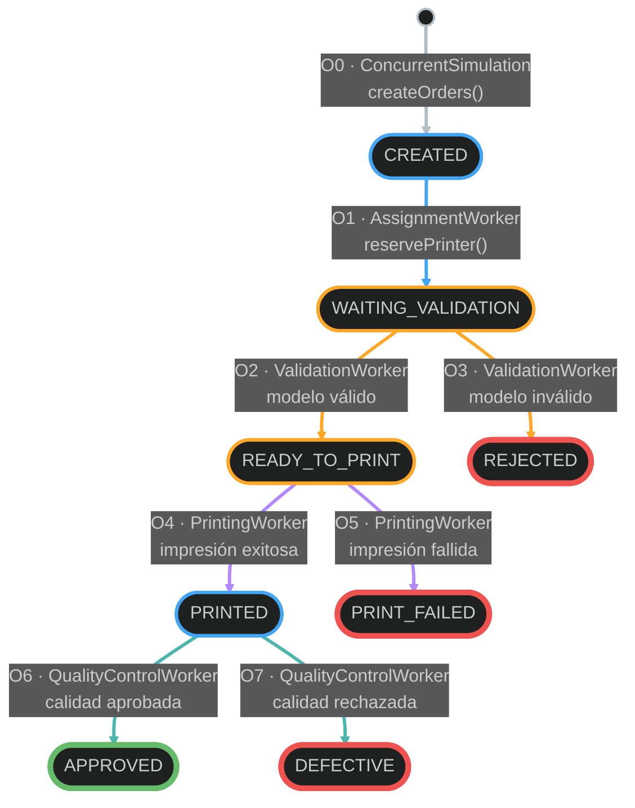
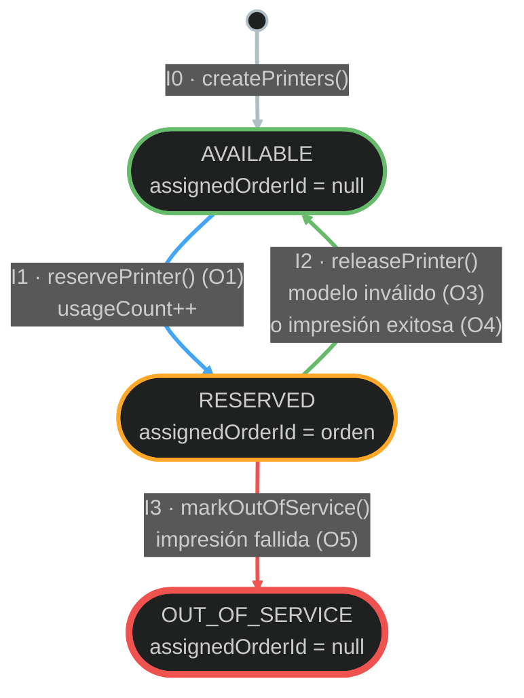

# Diagramas de estados

Estados de las órdenes (`OrderState`) y de las impresoras (`PrinterState`) según el modelo de clases
acordado ([diagrama-de-clases.md](diagrama-de-clases.md)).

## Orden de impresión

Cada orden se crea en `CREATED` y termina en exactamente uno de los cuatro estados terminales
(borde grueso). El color del borde indica si la orden tiene una impresora reservada; el color de la
flecha indica qué worker ejecuta la transición.

### Referencias

| Color del borde | Significado |
|---|---|
| Azul | Estado intermedio **sin** impresora reservada (`CREATED`, `PRINTED`) |
| Naranja | Estado intermedio **con** impresora reservada (`WAITING_VALIDATION`, `READY_TO_PRINT`) |
| Verde, grueso | Estado terminal exitoso (`APPROVED`) |
| Rojo, grueso | Estado terminal no exitoso (`REJECTED`, `PRINT_FAILED`, `DEFECTIVE`) |

| Color de la flecha | Quién ejecuta la transición | Hilos (config. oficial) | Cola de la que toma la orden |
|---|---|---|---|
| Gris | `ConcurrentSimulation` | `main` | — (la pone en `assignmentQueue`) |
| Azul | `AssignmentWorker` | 3 | `assignmentQueue` |
| Naranja | `ValidationWorker` | 2 | `validationQueue` |
| Violeta | `PrintingWorker` | 3 | `printingQueue` |
| Verde azulado | `QualityControlWorker` | 2 | `qualityQueue` |

### Transiciones

| # | Transición | Worker | Condición | Efecto sobre la impresora | Contador de `Order` | Después |
|---|---|---|---|---|---|---|
| O0 | — → `CREATED` | `ConcurrentSimulation` | Creación de la orden | Ninguno | — | `put` en `assignmentQueue` |
| O1 | `CREATED` → `WAITING_VALIDATION` | `AssignmentWorker` | Hay una impresora `AVAILABLE` (si no, `reservePrinter` espera) | `reservePrinter`: `AVAILABLE` → `RESERVED` | `assignmentCount++` | `put` en `validationQueue` |
| O2 | `WAITING_VALIDATION` → `READY_TO_PRINT` | `ValidationWorker` | `isModelValid` = true | Sigue `RESERVED` | `validationCount++` | `put` en `printingQueue` |
| O3 | `WAITING_VALIDATION` → `REJECTED` | `ValidationWorker` | `isModelValid` = false | `releasePrinter`: `RESERVED` → `AVAILABLE` | `validationCount++` | Termina |
| O4 | `READY_TO_PRINT` → `PRINTED` | `PrintingWorker` | `isPrintSuccessful` = true | `releasePrinter`: `RESERVED` → `AVAILABLE` | `printingCount++` | `put` en `qualityQueue` |
| O5 | `READY_TO_PRINT` → `PRINT_FAILED` | `PrintingWorker` | `isPrintSuccessful` = false | `markOutOfService`: `RESERVED` → `OUT_OF_SERVICE` | `printingCount++` | Termina |
| O6 | `PRINTED` → `APPROVED` | `QualityControlWorker` | `isQualityApproved` = true | No usa impresora | `qualityControlCount++` | Termina |
| O7 | `PRINTED` → `DEFECTIVE` | `QualityControlWorker` | `isQualityApproved` = false | No usa impresora | `qualityControlCount++` | Termina |

Cada transición se registra como un evento en `SimulationLogger`. Los recorridos posibles y los
contadores de la orden (`assignment` / `validation` / `printing` / `qualityControl`) son:

| Estado final | Recorrido | Contadores |
|---|---|---|
| `REJECTED` | O0 → O1 → O3 | 1 / 1 / 0 / 0 |
| `PRINT_FAILED` | O0 → O1 → O2 → O5 | 1 / 1 / 1 / 0 |
| `DEFECTIVE` | O0 → O1 → O2 → O4 → O7 | 1 / 1 / 1 / 1 |
| `APPROVED` | O0 → O1 → O2 → O4 → O6 | 1 / 1 / 1 / 1 |

## Impresora

Cada impresora comienza en `AVAILABLE`. `OUT_OF_SERVICE` es final dentro de la ejecución: la
impresora no vuelve a usarse. Todas las transiciones las hace `PrinterManager`, dentro de su
sección crítica, y cada una ocurre junto con una transición de la orden asociada (entre paréntesis).

### Transiciones

| # | Transición | Método de `PrinterManager` | Disparada por | Cambios | ¿Despierta a alguien? |
|---|---|---|---|---|---|
| I0 | — → `AVAILABLE` | — (`createPrinters()` de `ConcurrentSimulation`) | Inicio de la simulación | `usageCount = 0`, sin orden asignada | — |
| I1 | `AVAILABLE` → `RESERVED` | `reservePrinter` | O1 (`AssignmentWorker`) | `usageCount++`, `assignedOrderId = orden` | No |
| I2 | `RESERVED` → `AVAILABLE` | `releasePrinter` | O3 (`ValidationWorker`) u O4 (`PrintingWorker`) | `assignedOrderId = null` | Sí: a los `AssignmentWorker` que esperan en `reservePrinter` |
| I3 | `RESERVED` → `OUT_OF_SERVICE` | `markOutOfService` | O5 (`PrintingWorker`) | `assignedOrderId = null`; no vuelve a asignarse | No: no hay una impresora nueva disponible |

| Estado | ¿Puede recibir órdenes? | ¿Tiene orden asignada? |
|---|---|---|
| `AVAILABLE` | Sí | No |
| `RESERVED` | No | Sí, exactamente una |
| `OUT_OF_SERVICE` | No, nunca más en la ejecución | No |

Al terminar la simulación ninguna impresora puede quedar en `RESERVED`, y la suma de `usageCount` de
todas las impresoras es igual a la cantidad total de órdenes, porque cada orden pasa exactamente una
vez por O1.
