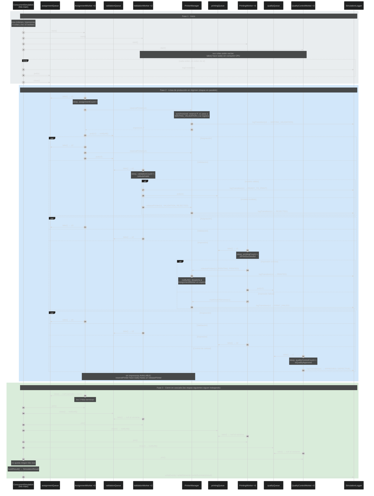

# Diagrama de secuencia

El diagrama muestra la simulación completa con el modelo de clases acordado. Se ve que las cuatro etapas
trabajan **al mismo tiempo** sobre órdenes distintas (bloques `par`), y que el hilo principal solo
espera para **cerrar** cada cola en cascada, sin frenar a los workers.

Cantidad de hilos por etapa (configuración oficial): asignación 3, validación 2, impresión 3 y
control de calidad 2. Cada participante `…Worker` representa a todos los hilos de su etapa.

## Cómo leerlo

| Fase | Qué muestra |
|---|---|
| 1 · Inicio | Todos los workers se inician **antes** de que haya trabajo. Los que no tienen órdenes quedan en `wait()` dentro de `take()`, sin espera activa. El bucle registra cada orden como creada (`logCreated`) y recién después la pone en `assignmentQueue`, una por una: así ningún asignador puede registrar su transición antes que la creación. Después la cola se cierra enseguida porque no van a llegar más. |
| 2 · Régimen | Cada bloque `par` es un instante en el que varias etapas trabajan a la vez sobre órdenes distintas: mientras validación procesa `o1`, asignación ya procesa `o2`, y así. El tiempo total se aproxima al de la etapa más lenta, no a la suma de las cuatro. |
| 3 · Cierre | El hilo principal hace `join()` de una etapa y recién ahí cierra la cola de la siguiente, porque ya nadie puede ponerle órdenes. Los workers de esa etapa terminan de vaciarla y reciben `null`. Ninguna etapa espera a la anterior para empezar; solo el **cierre** es escalonado. Al final se arma el resultado y recién después se escriben los tres archivos, porque `resumen.properties` usa ese resultado. |

## Recursos compartidos y sincronización

| Recurso | Mecanismo | Quién espera / quién despierta |
|---|---|---|
| Cada `StageQueue` | `synchronized` + `wait`/`notifyAll` | `take()` espera mientras esté vacía y abierta; `put()` y `close()` despiertan. |
| `PrinterManager` | `synchronized` + `wait`/`notifyAll`. En la misma sección crítica cambia la impresora, cambia el estado de la orden y registra el evento | `reservePrinter` espera si no hay `AVAILABLE`; `releasePrinter` despierta; `markOutOfService` no. |
| `SimulationLogger` | `synchronized` | Solo exclusión mutua sobre `sequence` y la lista de eventos (`logCreated`, `logTransition`). |
| `Order` | Sin lock | La tiene un solo worker a la vez; el `put`/`take` sincronizado garantiza la visibilidad. |

Orden de locks: `PrinterManager` → `SimulationLogger`. El logger nunca llama al `PrinterManager`, por lo
que no puede haber deadlock entre ambos.
